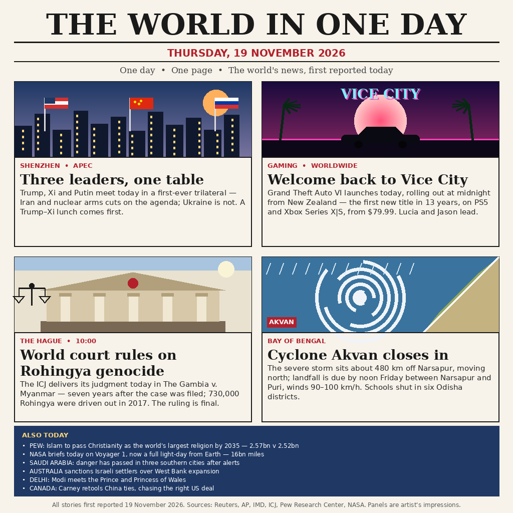

[](https://make.fun/bounty/news-image-20261119?utm_source=github&utm_medium=readme&utm_campaign=news-image-20261119)
[](https://make.fun/bounty/news-image-20261119/leaderboard?utm_source=github&utm_medium=readme&utm_campaign=news-image-20261119)
[](https://make.fun/bounty/news-image-20261119?utm_source=github&utm_medium=readme&utm_campaign=news-image-20261119)

# The World in One Day — Thursday, 19 November 2026

Entry for the make.fun competition
[news-image-20261119](https://make.fun/c/news-image-20261119):
sum up 19 November 2026's world news in one image.



## What the image shows

A newspaper front page for Thursday, 19 November 2026, built from four
illustrated panels plus a ticker of further stories first reported the
same day:

1. **Three leaders, one table** — Trump, Xi and Putin meet in Shenzhen
   in the first-ever trilateral, on the sidelines of the APEC leaders'
   meeting; Iran and nuclear arms cuts are on the agenda, Ukraine is not.
   A Trump–Xi lunch comes first. (Reuters, 16–18 Nov.)
2. **Welcome back to Vice City** — Grand Theft Auto VI launches today,
   rolling out at midnight from New Zealand: the first new title in
   13 years, on PS5 and Xbox Series X|S from $79.99, led by Lucia and
   Jason. (AP, Reuters, 18–19 Nov.)
3. **World court rules on Rohingya genocide** — the ICJ delivers its
   judgment today at 10:00 in The Hague in The Gambia v. Myanmar, seven
   years after the case was filed; 730,000 Rohingya were driven out in
   2017. The ruling is final. (Reuters, ICJ, 18–19 Nov.)
4. **Cyclone Akvan closes in** — the severe storm sits about 480 km off
   Narsapur, moving north; landfall is due by noon Friday between
   Narsapur and Puri, winds 90–100 km/h, and schools are shut in six
   Odisha districts. (IMD bulletin 27, 02:30 IST 19 Nov.)

Also today: Pew projects Islam passing Christianity as the world's
largest religion by 2035 (2.57bn v 2.52bn); NASA briefs on Voyager 1,
now a full light-day from Earth; Saudi Arabia says danger has passed
in three southern cities after alerts; Australia sanctions Israeli
settlers; Modi meets the Prince and Princess of Wales; Canada's
Carney retools China ties.

The four panels are artist's impressions, drawn from the reported
events; every fact and figure in the captions was checked against
news first reported on 19 November 2026. Stories from earlier days —
the Jeffries nomination vote, the Voyager crossing itself, the Fed
minutes — were deliberately left out or kept to what happened today:
this page is 19 November alone.

## How it is built

`compose.py` draws the front page offline with Pillow and a real
font, so all text in the image is crisp and correct. `main.ts`
(Node 22, standard library only) copies the composed `entry.png`
to `$MAKEFUN_OUTPUT_DIR/entry.png`, first proving it is a whole PNG
or JPEG inside the limits — at most 1 MiB, at most 1024 by 1024 px —
by reading its header. It runs with no network and writes identical
bytes on every run (verified: two local runs, same sha256).

Run it locally:

```sh
mkdir -p out && MAKEFUN_OUTPUT_DIR=out node main.ts
```

## License

MIT — see [LICENSE](LICENSE).
